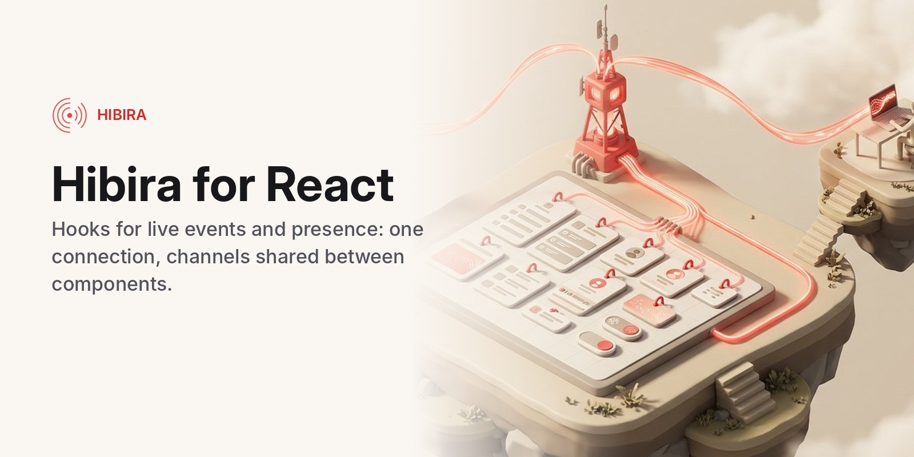

# @hibira-io/react



[](https://www.npmjs.com/package/@hibira-io/react)
[](https://github.com/hibira-io/react/actions/workflows/ci.yml)

React hooks for [pusher-js](https://github.com/pusher/pusher-js) on
[Hibira](https://hibira.io), or any Pusher-compatible server: one connection
for the app, channels shared between components, events, presence members,
connection state and client events. It also streams LLM output to the
browser: `streamToChannel()` sends tokens from your backend in batched
events, and `useStream()` puts them back together, for every tab and every
person on the channel at once.

- React 17, 18 and 19; server rendering safe (Next.js, Remix): nothing
  connects until the provider mounts in the browser.
- StrictMode safe: double mounts never leave a second socket or a dangling
  subscription.
- Works with Laravel Echo: pass `echo.connector.pusher` as the client.
- Plain ESM with TypeScript types, no build step, no dependencies besides
  `pusher-js`.

Using Vue or Nuxt? See [@hibira-io/vue](https://github.com/hibira-io/vue).

## Install

```sh
npm install @hibira-io/react pusher-js
```

## Setup

Wrap your app once. The app key is in the Hibira portal; it is public.

```jsx
import { HibiraProvider } from '@hibira-io/react';

export function App() {
  return (
    <HibiraProvider
      appKey={import.meta.env.VITE_HIBIRA_KEY}
      options={{ channelAuthorization: { endpoint: '/api/hibira/auth', transport: 'ajax' } }}
    >
      <Dashboard />
    </HibiraProvider>
  );
}
```

`options` are [pusher-js options](https://github.com/pusher/pusher-js#configuration),
merged over the Hibira defaults (`wsHost: 'ws.hibira.io'`, `forceTLS`, and the
`cluster` pusher-js insists on). For a local server set `wsHost`, `wsPort` and
`forceTLS: false`.

In the Next.js App Router, put the provider in a client component
(`'use client'`) and use it from your root layout.

With Laravel Echo, reuse its connection:

```jsx
<HibiraProvider client={window.Echo.connector.pusher}>
```

## Hooks

```jsx
import { useChannel, useEvent, usePresence, useTrigger, useConnectionState } from '@hibira-io/react';

function Orders() {
  const [orders, setOrders] = useState([]);
  useEvent('orders', 'order.created', (order) => setOrders((list) => [order, ...list]));
  return <OrderList orders={orders} />;
}

function Room({ id }) {
  const { members, others, me, count } = usePresence(`presence-room-${id}`);
  const trigger = useTrigger(`presence-room-${id}`);
  useEvent(`presence-room-${id}`, 'client-typing', (data, { user_id }) => showTyping(user_id));
  return <input onInput={() => trigger('client-typing', {})} />;
}

function StatusDot() {
  const state = useConnectionState(); // 'connecting' | 'connected' | 'unavailable' | ...
  return <span className={state} />;
}
```

| Hook | Returns |
| --- | --- |
| `usePusher()` | the pusher-js client, or `null` before it opens and on the server |
| `useChannel(name)` | the channel, or `null`; subscribed while mounted, shared by every component using the same name; `null` subscribes to nothing |
| `useEvent(channel, event, handler)` | the channel; `handler(data, metadata)` may change on every render without rebinding |
| `usePresence(channel)` | `{ members, others, me, count, channel }`; members are `{ id, info, me }`, you first; `info` is the `user_info` your auth endpoint signed |
| `useTrigger(channel)` | `trigger('client-…', data)`, `false` until subscribed; turn on client events for the app in the portal |
| `useConnectionState()` | `'initialized'`, `'connecting'`, `'connected'`, `'unavailable'`, `'failed'` or `'disconnected'` |
| `useStream(channel, { id, event, rewind })` | `{ text, done, error, stream, streams, history, reset }`, see below |
| `useAgentStream(channel, { invocationId, rewind })` | `{ text, reasoning, status, done, error, toolCalls, approvals, run, runs, history, reset }` for Laravel AI SDK agents, see below |

Wherever a hook takes a channel, pass a name (it subscribes) or a channel
object you already have, such as Echo's `Echo.private('x').subscription`.

## Auth endpoint

Private and presence channels need a route on your backend that checks who
is signed in and signs the subscription. `endpoint` in `channelAuthorization`
points to it. With Next.js:

```js
// app/api/hibira/auth/route.js
import Pusher from 'pusher';

const pusher = new Pusher({
  appId: process.env.HIBIRA_APP_ID,
  key: process.env.HIBIRA_KEY,
  secret: process.env.HIBIRA_SECRET,
  host: 'ws.hibira.io', // the host shown on your app page
  useTLS: true,
});

export async function POST(req) {
  const user = await getUser(req); // your session check
  if (!user) return new Response('Unauthorized', { status: 401 });
  const form = await req.formData(); // pusher-js sends a form post
  const socketId = form.get('socket_id');
  const channel = form.get('channel_name');
  if (!mayJoin(user, channel)) return new Response('Forbidden', { status: 403 });
  const presence = channel.startsWith('presence-')
    ? { user_id: String(user.id), user_info: { name: user.name } }
    : undefined;
  return Response.json(pusher.authorizeChannel(socketId, channel, presence));
}
```

The app ID and key are on the app's page in the Hibira portal; the secret
is shown only once, when you create the app, so store it in your backend's
environment then. On the Free plan, add your site's origin (for example
`http://localhost:3000`) to the app's allowed origins, or browsers can't
connect.

## Streaming LLM output

Send the model's stream from your backend with `streamToChannel()`. It
takes the stream of the Anthropic, OpenAI and Gemini SDKs and the Vercel AI
SDK as they are, an async iterable of strings, or a `ReadableStream`.

```js
// app/api/ask/route.js (Next.js); any Node backend works the same way
import Pusher from 'pusher';
import Anthropic from '@anthropic-ai/sdk';
import { streamToChannel } from '@hibira-io/react/server';

const pusher = new Pusher({
  appId: process.env.HIBIRA_APP_ID,
  key: process.env.HIBIRA_KEY,
  secret: process.env.HIBIRA_SECRET,
  host: 'ws.hibira.io', // the host shown on your app page
  useTLS: true,
});
const anthropic = new Anthropic();

export async function POST(req) {
  const { conversationId, question } = await req.json();
  const stream = anthropic.messages.stream({
    model: 'claude-sonnet-5-5',
    max_tokens: 1024,
    messages: [{ role: 'user', content: question }],
  });
  // Don't await: answer the request now and keep streaming to the channel.
  const id = crypto.randomUUID();
  streamToChannel(pusher, `private-conversation-${conversationId}`, stream, { id, meta: { role: 'assistant' } })
    .catch((err) => console.error('stream failed', err));
  return Response.json({ id });
}
```

On a serverless platform, keep the function alive until the stream ends
(`waitUntil()` on Vercel and Cloudflare, or await it). Then in the browser:

```jsx
import { useStream } from '@hibira-io/react';

function Answer({ conversationId }) {
  const { text, done, error } = useStream(`private-conversation-${conversationId}`);
  return (
    <p aria-busy={!done}>
      {text}
      {error && <em> (stopped: {error})</em>}
    </p>
  );
}
```

Every subscriber sees the same answer as it is written: other tabs, other
devices, teammates in a shared conversation. `useStream()` follows the stream
that started last; pass `{ id }` to follow one, or read `streams` for all of
them (by id, each `{ id, text, done, error, meta, incomplete }`).

`streamToChannel(pusher, channel, source, options)` options:

| Option | Default | |
| --- | --- | --- |
| `id` | random UUID | stream id, also returned |
| `event` | `'ai-stream'` | event name |
| `interval` | `100` | ms to gather tokens into one event |
| `maxBytes` | `3500` | largest event; Free plans allow 4 KB per message |
| `meta` | | JSON sent with the first event (model, message id, author) |
| `pick` | | `(chunk) => text` for a source it does not know |
| `socketId` | | leave out the sender's own connection |
| `signal` | | an `AbortSignal` to stop; subscribers get `error: 'aborted'` |

It resolves to `{ id, text, events }` once the last event is sent, and
rejects when the source or the HTTP API fails, after telling subscribers.

How it works: tokens are batched into one event per `interval` (100 ms by
default), so a model writing 50 tokens a second sends about 10 events a
second rather than 50. Each event carries a sequence number and
`useStream()` applies them in order. The last event carries the whole text
when it fits in one message, so someone who subscribed halfway through, or
whose connection dropped for a moment, still ends with the full answer;
otherwise their stream is marked `incomplete`.

### Reloads and dropped connections: `rewind`

Turn on channel history for the app (app settings in the Hibira portal,
Hobby plans and up) and pass `rewind`, and nothing is lost: a page reloaded
halfway through an answer, or a phone that lost signal for a few seconds,
picks the answer up from its first token.

```jsx
const { text, done, history } = useStream(`private-conversation-${conversationId}`, { rewind: true });
```

Each time the channel is subscribed, the first time and again after a
reconnect, `useStream()` asks the server for the events it missed
(`pusher:rewind`): the last 300 seconds the first time, the time since the
last event after a reconnect. Live events are held for that moment and
everything is applied in order, without duplicates.

| `rewind` option | Default | |
| --- | --- | --- |
| `seconds` | `300` | history asked for on the first subscription (the app's history window caps it) |
| `limit` | all kept | at most this many events |
| `timeout` | `5000` | ms to wait for the server before going on without history |

`history` is the last answer: `{ count, window, complete }`, or `{ error }`
when history is off or not in the app's plan (the stream then works as
without `rewind`). Replayed events reach every listener on the channel.
For other frameworks, `followStream(channel, { apply, rewind })` does the
same for any pusher-js channel.

Use a private or presence channel for anything personal, so only the people
your auth endpoint allows can subscribe.

## Laravel AI SDK agents: `useAgentStream`

For agents built with the [Laravel AI SDK](https://github.com/laravel/ai)
and broadcast with [`hibira-io/laravel`](https://github.com/hibira-io/laravel):

```php
// Laravel: queue the agent, stream its events to the user's private channel
use Hibira\Laravel\Ai\AgentChannel;

(new SalesCoach)->broadcastOnQueue($request->input('prompt'), AgentChannel::user($request->user()));
```

```jsx
const { text, reasoning, status, toolCalls, approvals, error } = useAgentStream(
  `private-hibira-ai.user.${user.id}`,
  { rewind: true },
);
```

It listens to every Laravel AI stream event (`text_delta`,
`reasoning_delta`, `tool_call`, `tool_result`, `tool_approval_request`,
`stream_end`, errors) and puts each run (one `invocation_id`) back together.
`status` is `idle`, `streaming`, `awaiting_approval`, `done` or `error`;
`run.parts` lists text, reasoning and tool calls in the order they started,
for rendering a chat transcript. Events bigger than the plan's per-event
limit (4 KB on Free) arrive split into `hibira:chunk` events, which are
joined; replays from `rewind` are dropped by event id.

| Option | Default | |
| --- | --- | --- |
| `invocationId` | | follow only this run; otherwise the one that started last |
| `rewind` | off | as for `useStream()` |
| `maxRuns` | `20` | runs kept, oldest dropped first |
| `events` | | extra event names, such as a provider's own error types |

`createAgentStore(onChange)` is the same without React, for any pusher-js
channel.

## Licence

MIT
